# Task Session 1: Multi-container Pods (Init Container & Sidecar)

## Goal

Run an nginx "hello" page on a 3-node minikube cluster whose timestamp refreshes every 5 seconds, using an init container and a sidecar in each Pod with no volumes, then break the init container on purpose and observe how Kubernetes reacts.

## Files

| File | Description |
|------|-------------|
| `deployment.yaml` | Deployment `web-deployment` (3 replicas, namespace `webapp`), working version |
| `screenshots/` | Evidence for every step below |

## Pod design

Each Pod uses `shareProcessNamespace: true` and has no volumes:

| Container | Type | Job |
|-----------|------|-----|
| `init-done` | Init container | Prints `done` and exits. The other containers start only if it succeeds. |
| `nginx` | Main container | Writes `index.html` with the current time, then serves it on port 80 |
| `time-updater` | Sidecar | Every 5 seconds finds the nginx PID and rewrites `index.html` through `/proc/<pid>/root` (capability `SYS_PTRACE`) |

---

## 1. Cluster setup

```bash
minikube start --nodes 3 --cni=calico --cpus 2 --memory 2200
kubectl get nodes
kubectl create namespace webapp
```

All 3 nodes (`minikube`, `minikube-m02`, `minikube-m03`) are `Ready`.

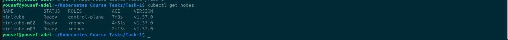

---

## 2. Deployment and pods running

```bash
kubectl apply -f deployment.yaml
kubectl get pods -n webapp -w
```

The 3 Pods reach `2/2 Running` (the init container has finished, so only `nginx` and `time-updater` count).

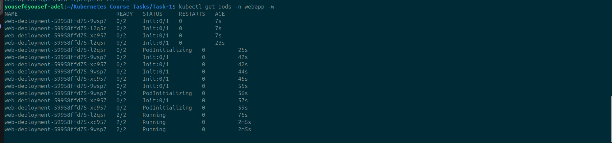

The Deployment is `3/3` ready:


The Pods are spread across the 3 nodes:

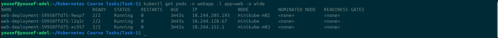

### Verification checks

**Init container succeeded** and printed `done`:


**The sidecar sees the nginx process** through the shared process namespace (`nginx: master process` appears in the sidecar's `ps`, next to the sidecar's own loop):

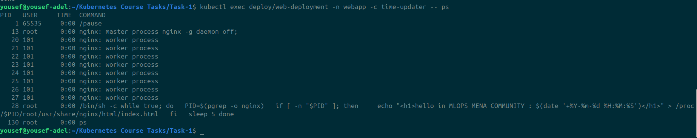

**No volumes** are defined: the `jsonpath` query for `.spec.template.spec.volumes` returns empty output (last command in the screenshot below).

---

## 3. Time updates (5 seconds apart)

Reading `index.html` from the `nginx` container twice, with `sleep` between the reads, shows the sidecar rewriting the file (`13:51:04` then `13:51:09`):

```bash
kubectl exec deploy/web-deployment -n webapp -c nginx -- cat /usr/share/nginx/html/index.html
sleep 6
kubectl exec deploy/web-deployment -n webapp -c nginx -- cat /usr/share/nginx/html/index.html
```

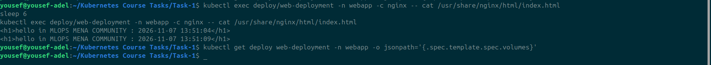

In the browser through `kubectl port-forward -n webapp deploy/web-deployment 8080:80`, the page updates from `13:54:05` to `13:54:10`:


---

## 4. Failure test: init container exits with code 1

Only the init command was changed in `deployment.yaml`:

```yaml
command: ["sh", "-c", "echo 'init failed'; exit 1"]
```

```bash
kubectl apply -f deployment.yaml
kubectl get pods -n webapp -w
```

### What happened

- The new Pod went `Init:Error` and then **`Init:CrashLoopBackOff`**, staying at `0/2` while Kubernetes kept restarting the init container.
- The 3 old Pods stayed `2/2 Running` the whole time.

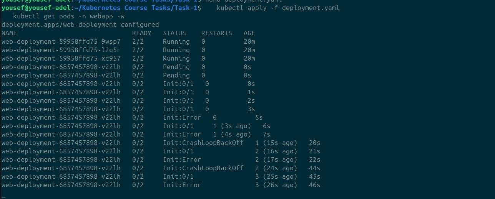

### Diagnosis

`kubectl describe pod web-deployment-6857457898-v22lh -n webapp`

- `init-done` is `Terminated` with **`Exit Code: 1`** and its restart count keeps growing:

  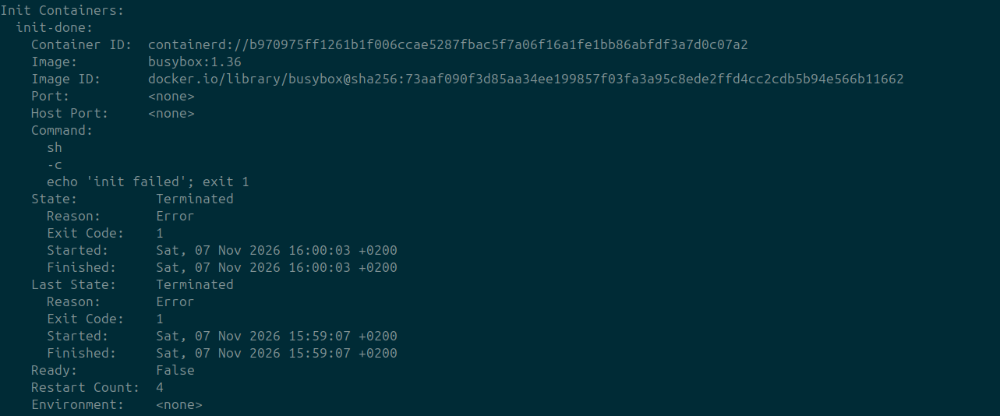

- `nginx` and `time-updater` never started. They stay in `Waiting` with reason `PodInitializing`:

  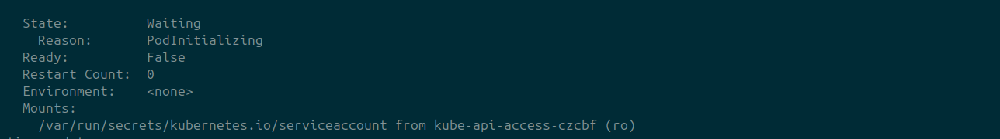

- The Pod conditions show `Initialized: False`, `Ready: False` and `ContainersReady: False`:

  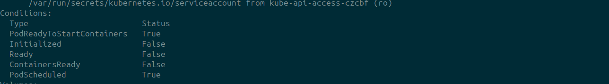

- The events show `Back-off restarting failed container init-done`:

  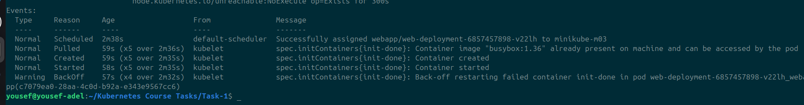

The rollout is stuck. Kubernetes will not finish it until the new Pod becomes healthy:

```bash
kubectl rollout status deploy/web-deployment -n webapp --timeout=20s
```

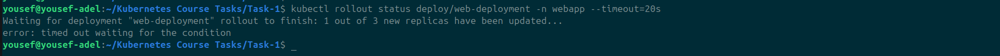

### Conclusions

- **Init containers gate the Pod.** `nginx` and `time-updater` never started because `init-done` never succeeded.
- **Zero downtime.** The old Pods kept running and serving the page, since a rolling update only removes old Pods as new ones become ready. A broken new version just makes the rollout stall.

---

## 5. Fix and final state

The init command was changed back to `["sh", "-c", "echo done"]`:

```bash
kubectl apply -f deployment.yaml
kubectl get pods -n webapp
kubectl get deploy web-deployment -n webapp
```

The failing Pod was removed and the Deployment is back to `3/3` ready with 3 Pods `2/2 Running`.

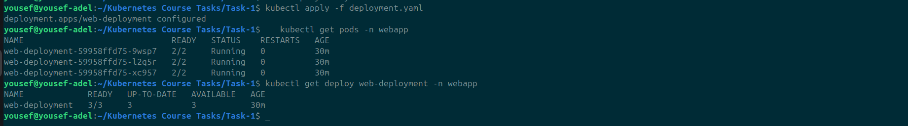

---

## Clean up (optional)

```bash
kubectl delete namespace webapp
```
