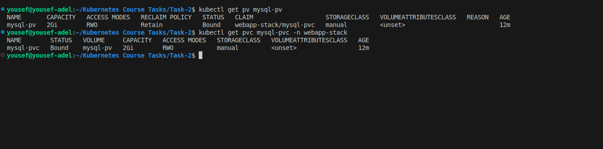
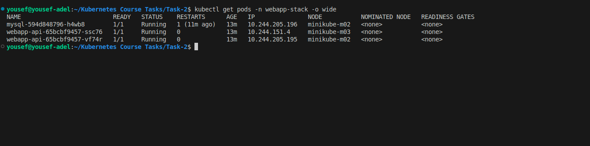
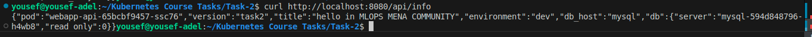
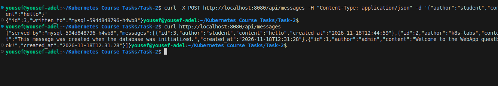
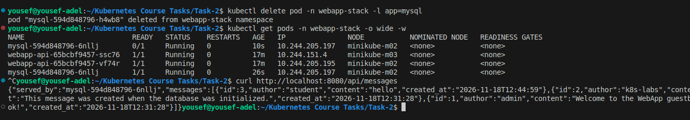

# Task 2: FastAPI + MySQL with ConfigMap, Secret & Ingress

## What was done
- Built `webapp-api:task2` and `webapp-mysql:task2` and loaded them into minikube.
- Namespace `webapp-stack`; Secret `mysql-secret`; ConfigMap `webapp-config`.
- 2Gi `hostPath` PV `mysql-pv` pinned to `minikube-m02` with nodeAffinity, bound to PVC `mysql-pvc`.
- MySQL Deployment (1 replica, `Recreate`) + Service; FastAPI Deployment (2 replicas) + Service.
- NGINX Ingress Controller + Ingress `webapp-ingress` on path `/`.

## Commands
```bash
minikube start
chmod -x mysql/initdb/01-setup.sh
docker build -t webapp-api:task2 ./webapp
docker build -t webapp-mysql:task2 ./mysql
minikube image load webapp-api:task2
minikube image load webapp-mysql:task2
minikube addons enable ingress
kubectl apply -f 01-namespace.yaml -f 02-secret.yaml -f 03-configmap.yaml -f 04-pv-pvc.yaml
kubectl apply -f 05-mysql.yaml -f 06-webapp.yaml -f 07-ingress.yaml
kubectl port-forward -n ingress-nginx svc/ingress-nginx-controller 8080:80
```

## Screenshots
### Bound PV / PVC

### Pods and node placement (MySQL on minikube-m02)

### Ingress access: /api/info

### Ingress access: /api/messages

### Data persistence after deleting the MySQL Pod

